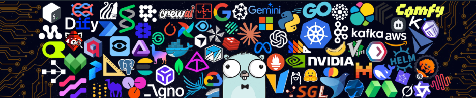

<!--
个人资料已预填：
- 显示名：ZNNW
- GitHub 用户名：ZNNW
- 职业：全栈 Agent 工程师
- 城市：广州
- 当前项目：Dashboard 中的 Top repositories

仍需替换：
1. 三张广州占位图
2. Twitter、LinkedIn、Medium 等社交账号
3. 博客、CSDN、掘金或公众号文章链接
4. 后续上传的主要项目
5. 将 assets/tech-banner.png 一并上传到仓库根目录

技术徽章已按你提供的信息更新，请按实际使用情况增删。

说明：左侧头像、姓名、简介、关注数、成就和 Pinned 仓库属于 GitHub
个人主页本身的区域，不由 README.md 控制，需要在 GitHub 设置中完善。
-->

<h1>😃嘿！很高兴见到你。</h1>

  

欢迎来到我的页面！  
我是 **ZNNW**，一名 **全栈 Agent 工程师**，目前居住在 **广州**。

我专注于 Java/Spring 生态、AI Agent 应用与企业级后端系统，关注 Spring AI、LangChain、RAG、微服务和高并发场景下的工程落地。我希望把大模型能力、工程架构和真实业务连接起来，让 Agent 从演示走向可运行、可观测、可维护的生产系统。

- **Agent 工程**：关注 Spring AI、LangChain、RAG、多智能体编排、Prompt Engineering 与工具调用。
- **后端开发**：熟悉 Java、Spring Boot、Spring Cloud、Spring AI 及 Spring AI Alibaba，理解 JUC、线程池与 JVM。
- **数据与中间件**：使用 MySQL、Redis、RabbitMQ、Elasticsearch 处理缓存、消息、检索与异步任务。
- **全栈协作**：熟悉 Vue、HTML/CSS/JavaScript，能够完成页面开发与前后端接口联调。
- **工程效率**：使用 Docker、Linux、Git、Maven、Apifox、JMeter，以及 Cursor、Codex 等 AI Coding 工具。
- **数据采集**：能够使用 Scrapy 完成页面抓取、数据解析与入库。
- **后续计划**：更多个人项目与工程实践正在整理和上传中。

### 我用来编程的东西

### 开源项目

| 📦 项目 | ⭐ 明星 | 🍴 分叉 | ⚠️ 议题 | 🔀 拉取请求 |
| :--- | ---: | ---: | ---: | ---: |
| [javaweb-engineering-lab](https://github.com/ZNNW/javaweb-engineering-lab) |  |  |  |  |
| [java-se-application-portfolio](https://github.com/ZNNW/java-se-application-portfolio) |  |  |  |  |
| [js-browser-engineering-lab](https://github.com/ZNNW/js-browser-engineering-lab) |  |  |  |  |
| [Frontend-learning-lab](https://github.com/ZNNW/Frontend-learning-lab) |  |  |  |  |
| [python-data-science-lab](https://github.com/ZNNW/python-data-science-lab) |  |  |  |  |
| [ShiZheYunSuangProject](https://github.com/ZNNW/ShiZheYunSuangProject) |  |  |  |  |
| [-3124004189](https://github.com/ZNNW/-3124004189) |  |  |  |  |

[查看全部仓库](https://github.com/ZNNW?tab=repositories)

### 最近在做的项目

- [javaweb-engineering-lab](https://github.com/ZNNW/javaweb-engineering-lab)  
  Java Web 工程实践与应用开发记录。
- [Frontend-learning-lab](https://github.com/ZNNW/Frontend-learning-lab)  
  前端基础、浏览器工程与交互实验。
- [python-data-science-lab](https://github.com/ZNNW/python-data-science-lab)  
  Python 数据分析、建模与可视化实验。

> 更多主要项目正在整理和上传中，完成后会补充到这里。

### 去广州！

  
  
  

广州是我目前生活和工作的城市。  
<!-- 如需天气和日出日落信息，可以接入 API 后在这里补充。 -->

### 去哪儿找我

<!-- 填写账号后取消注释：

-->

---

README · 最后更新：2026-10-20 

