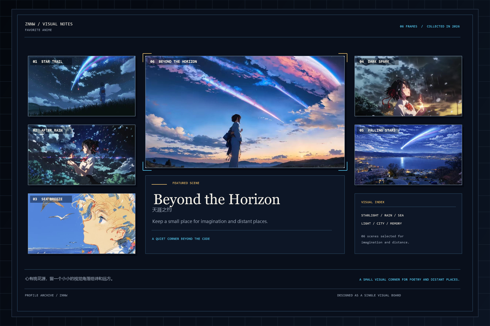

<!--
Bilingual profile README.
Assets: hero-typing.svg, tech-banner.png, anime-1.jpg.
Snake: generated by .github/workflows/snake.yml.
-->

  

  

  

  <a href="#en"><strong>English</strong></a>
  ·
  <a href="#zh"><strong>中文</strong></a>

## English Version

Hi, I'm **ZNNW**, a **Full-Stack Agent Engineer** based in **Guangzhou, China**.

I work across the Java/Spring ecosystem, AI Agent applications, and enterprise backend systems. My focus includes Spring AI, LangChain, RAG, microservices, and production engineering for high-concurrency workloads. I want to connect LLM capabilities, software architecture, and real business scenarios so agents can move beyond demos into systems that are runnable, observable, and maintainable.

- 🧐 **Agent Engineering**: Spring AI, LangChain, RAG, multi-agent orchestration, MCP, prompt engineering, and tool calling.
- 💼 **Backend Development**: Java, Spring Boot, Spring Cloud, Spring AI, and Spring AI Alibaba; JUC, thread pools, and JVM.
- 🎓 **Data & Middleware**: MySQL, Redis, RabbitMQ, and Elasticsearch for caching, messaging, search, and asynchronous tasks.
- 🌱 **Full-Stack Collaboration**: Vue, HTML/CSS/JavaScript, page development, and frontend-backend integration.
- 📚 **Engineering Efficiency**: Docker, Linux, Git, Maven, Apifox, JMeter, Cursor, and Codex.
- ⛵ **Data Collection**: Scrapy for web scraping, data parsing, and ingestion.
- ✈️ **Next**: More personal projects and engineering practice are being organized and uploaded.

## 中文版

欢迎来到我的主页，我是 **ZNNW**。  
我是一名 **全栈 Agent 工程师**，目前居住在 **广州**。

我专注于 Java/Spring 生态、AI Agent 应用与企业级后端系统，关注 Spring AI、LangChain、RAG、微服务和高并发场景下的工程落地。我希望把大模型能力、工程架构和真实业务连接起来，让 Agent 从演示走向可运行、可观测、可维护的生产系统。

- 🧐 **Agent 工程**：关注 Spring AI、LangChain、RAG、多智能体编排、MCP、Prompt Engineering 与工具调用。
- 💼 **后端开发**：熟悉 Java、Spring Boot、Spring Cloud、Spring AI 及 Spring AI Alibaba，理解 JUC、线程池与 JVM。
- 🎓 **数据与中间件**：使用 MySQL、Redis、RabbitMQ、Elasticsearch 处理缓存、消息、检索与异步任务。
- 🌱 **全栈协作**：熟悉 Vue、HTML/CSS/JavaScript，能够完成页面开发与前后端接口联调。
- 📚 **工程效率**：使用 Docker、Linux、Git、Maven、Apifox、JMeter，以及 Cursor、Codex 等 AI Coding 工具。
- ⛵ **数据采集**：能够使用 Scrapy 完成页面抓取、数据解析与入库。
- ✈️ **后续计划**：更多个人项目与工程实践正在整理和上传中。

### Tech Stack / 技术栈

### GitHub Stats / GitHub 数据统计

  

Language statistics are generated by GitHub Readme Stats and may take a few seconds to load. / 语言占比由 GitHub Readme Stats 生成，首次加载可能需要几秒钟。

### Contribution Snake 

  

### Open Source Projects / 开源项目

| 📦 Project / 项目 | ⭐ Stars / 星标 | 🍴 Forks / 分叉 | 🛎 Issues / 议题 | 📬 Pull Requests / PR |
| :--- | ---: | ---: | ---: | ---: |
| [javaweb-engineering-lab](https://github.com/ZNNW/javaweb-engineering-lab) |  |  |  |  |
| [java-se-application-portfolio](https://github.com/ZNNW/java-se-application-portfolio) |  |  |  |  |
| [js-browser-engineering-lab](https://github.com/ZNNW/js-browser-engineering-lab) |  |  |  |  |
| [Frontend-learning-lab](https://github.com/ZNNW/Frontend-learning-lab) |  |  |  |  |
| [python-data-science-lab](https://github.com/ZNNW/python-data-science-lab) |  |  |  |  |
| [ShiZheYunSuangProject](https://github.com/ZNNW/ShiZheYunSuangProject) |  |  |  |  |
| [-3124004189](https://github.com/ZNNW/-3124004189) |  |  |  |  |

[View all repositories / 查看全部仓库](https://github.com/ZNNW?tab=repositories)

### Recent Projects / 最近在做的项目

- 📦 [javaweb-engineering-lab](https://github.com/ZNNW/javaweb-engineering-lab)  
  Java Web 工程实践与应用开发记录 / Java Web engineering practice and application development notes.
- 📦 [Frontend-learning-lab](https://github.com/ZNNW/Frontend-learning-lab)  
  前端基础、浏览器工程与交互实验 / Frontend fundamentals, browser engineering, and interaction experiments.
- 📦 [python-data-science-lab](https://github.com/ZNNW/python-data-science-lab)  
  Python 数据分析、建模与可视化实验 / Python data analysis, modeling, and visualization experiments.

> 更多主要项目正在整理和上传中。 / More major projects are being organized and uploaded.

### Favorite Anime / 我喜欢的动漫

  

心有桃花源，留一个小小的视觉角落给诗和远方。  
These are some of my favorite anime scenes. I keep a small visual corner here for imagination and distant places.

### Find Me / 去哪儿找我

---

README · Last updated / 最后更新：2026-10-20 

